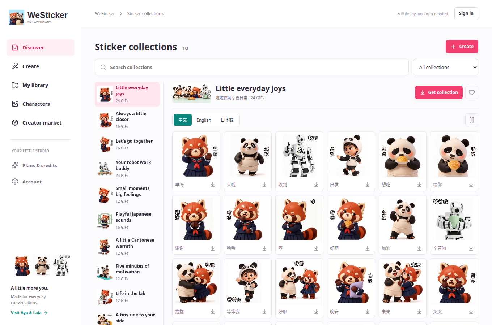

# Chat Workspace Internal Release

Historical earlier release. The [login/chat update](login-chat-release-20261011.md)
supersedes its build numbers and pending password-login status.

Verified 11 October 2026. Create and Agent share one workspace, with editable
caption/action tables, Library and Characters. The saved on-device photo editor
remains accessible. iOS and macOS are SwiftUI; Android is Compose, not WebViews.

## Distribution

| Platform | Version | Verified provider state |
| --- | --- | --- |
| iOS | 1.0 (6) | VALID, WeSticker Internal, IN_BETA_TESTING |
| macOS | 1.0 (5) | VALID, WeSticker Internal, IN_BETA_TESTING |
| Android | 1.0 (5) | Available to internal testers, released October 11 |

Existing Apple testers can update in TestFlight. Android testers use the
[existing internal track](https://play.google.com/apps/internaltest/4701650698244827462).
Neither platform was submitted to public production review. Provider receipts,
signed artifacts and test logs are preserved privately. Nutstore copies have
matching local SHA-256 hashes; that alone does not prove cloud synchronization.

| Artifact | SHA-256 |
| --- | --- |
| Android APK | `a9567bb1cf6d19f53af4b075b17477c504c8ac0eaf5d737eedd68d15a5e58273` |
| Android AAB | `11c21b01e446e74296f471565377d2b430c814ac89cdd2f2818657088037e80a` |
| iOS IPA | `597f68fad6eb8df1a2d424636af8d22e68c9b936e3c496fae168f316f3b4f119` |
| macOS PKG | `fb8ceb8792d094184ac94eae3197833cbd810f86fe2cead5ddfd58a618e094a0` |

## Available And Gated

- Guest catalog, animated previews, language variants and individual sharing work.
- Native Create/Library/Characters and preserved local photo drafts are included.
- A real LocalLLM chat call returned an editable proposal. The connected photo
  workflow also passes isolated web and prior native API tests.
- Public account creation is not enabled. The app-owned shared-client registry
  request is with the identity owner; its live callback round-trip is pending.
  Do not mistake a visible Create tab for working public cloud generation.
- Image generation, animation, subscriptions, creator sales and customer WeChat
  automation remain disabled until their providers and lifecycle tests pass.
- Google/Apple/GitHub social login is not qualified by a successful store upload.

The canonical creator origin is <https://westicker.lazying.art>. The separate
[AYA catalog PWA](https://aya.lazying.art/westicker/) and shop remain unchanged.



## Verification

- 72 backend tests with the optional identity SDK installed, plus two WeChat
  draft-agent safety tests. SDK fixtures are not live issuer qualification.
- Web production build and isolated chat/photo/editor workflows pass. The
  browser catalog test passes using approved local artwork to avoid repeated
  large network transfers; live edge testing separately checks animated previews.
- Exact signed Android APK: catalog GIF pixel movement, pause/resume, preview,
  sharing, merged tabs and restored local-editor navigation pass in the emulator.
- iOS simulator: `testUnifiedCreatorAndLocalDraftPersistence` passes. This is not
  a physical-device or public shared-login test.
- macOS: native compilation, signing, packaging and TestFlight processing pass.
  No new full macOS UI automation run was claimed for this candidate.
- Live HTTPS checks at 390/1360 pixels: no horizontal overflow, animated preview,
  Create navigation, no page errors, private asset/workspace rejection, spoofed
  relay headers rejected, foreign-Origin writes rejected and API `no-store`.
- Nine existing AYA edge checks pass unchanged, including download and hotlink
  rules. No firewall changes, paid renders or customer data migrations occurred.

## Deployment Notes

`scripts/stage_creator_runtime.py` creates a content-addressed backend/web
snapshot, including the catalog used by API download validation. The edge's
`scripts/deploy_creator_edge.py` verifies the archive and exact previous Caddy
hash, adds only the separate hostname and restricted SSH user, validates Caddy
before reload and retains rollback evidence. Private relay and identity inputs
are outside Git. The local SDK is installed from a pinned private wheel, not an
editable checkout.

The edge overwrites every relay header consumed by `server/ingress.py`. Do not
combine those setters with a wildcard deletion of the same namespace: that
removed the relay credential during preflight. Explicit route ordering also
keeps denied API methods out of the static fallback. See Caddy's
[upstream header rules](https://caddyserver.com/docs/caddyfile/directives/reverse_proxy#headers).

The three owned user services are creator API, worker and restricted tunnel;
they restart on failure. They use their own state and do not expose model,
browser, CDP or desktop management endpoints. Shared-login remains disabled
until its exact registration and app round-trip pass.

The macOS exporter now selects the explicitly configured installer keychain
ahead of unrelated remembered keychains and restores the prior search list.
Build scripts record the actual candidate scope instead of catalog-only notes.

```sh
.venv/bin/pytest -q
node --test tests/wechat.test.mjs
npm run build
.venv/bin/python scripts/test_studio_isolated.py chat
.venv/bin/python scripts/test_studio_isolated.py local
node scripts/creator_edge_test.mjs
.venv/bin/python scripts/catalog_edge_check.py
```
