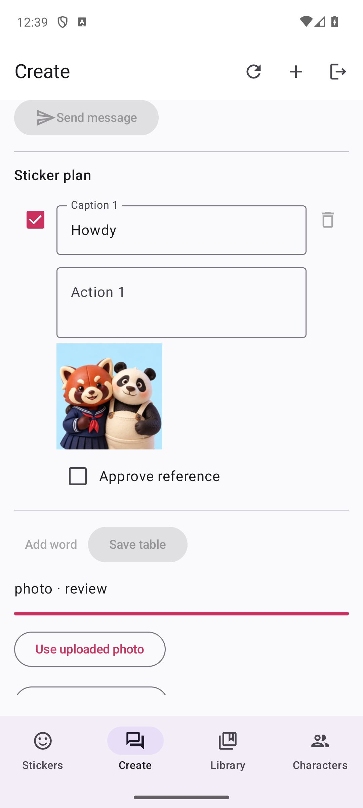

# Chat-First Creator Workspace

This is a source/local-test milestone, not a new public deployment or store
release. The public catalog and previously distributed betas are unchanged.
AYA shop, purchases and existing WeChat albums are untouched.


## Workflow

1. Open **Create**, sign in, and choose an existing character or upload up to five
   owned references. Confirm rights and reference identity.
2. Name the collection and choose its lettering language. The account plan
   determines how many rows can be created.
3. Chat produces a proposed caption/action table. **Apply table** commits the
   proposal; chat alone neither alters approved work nor starts generation.
4. Edit captions and actions directly. Saving checks the revision so a stale
   proposal or another device cannot silently overwrite newer work.
5. Select rows, request a quote, then explicitly confirm photo, AI-reference or
   animation work. Approve generated references before animation. Edits clear
   approval; changed selections invalidate quotes.
6. Review the result and export the reviewed ZIP. **Library** and **Characters**
   reopen account-owned work. Version history preserves earlier generated assets.

The old local photo draft remains accessible through **Saved local photo draft**.
It stays on the device; opening or exporting that draft does not upload it.
The top-level Agent tab is now part of Create, not a separate planner.

## Tier Contract

| Effective plan | Rows per creation/job | Saved collections | Characters | Animation |
| --- | ---: | ---: | ---: | --- |
| Free | 1 | 2 single-sticker creations | 2 | No |
| Pocket | 8 | 2 packs | 2 | No |
| Creator | 16 | 25 packs | 25 | Yes, with provider |
| Studio | 24 | 100 packs | 100 | Yes, with provider |

Free accounts have one lifetime trial image reservation, not a recurring pack
allowance. Photo mode costs zero credits. Image generation costs one credit per
selected row; animation costs three. Existing proposed prices remain unchanged:
Pocket $0.99, Creator $9.99 and Studio $24.99 per month. Billing is not enabled by
this change. These caps require provider-cost validation before public launch.

Expired subscriptions revert to free generation limits without deleting older
packs. Larger existing tables may still be reviewed/exported, but free generation
is limited to one selected row and one unresolved job at a time. Caps and credit
reservations are enforced server-side, not just in UI controls.

## Shared Contracts

- `POST /api/packs/{id}/chat`: idempotent message attempt; returns a proposal and
  the draft revision it was based on.
- `PATCH /api/packs/{id}`: applies the complete edited table and checks revision.
- `POST /api/packs/{id}/quote`: selected rows, provider/plan checks, cost and revision.
- `POST /api/packs/{id}/generate`: explicit consent and stable attempt ID.
- `GET /api/packs/{id}/conversation` and `/versions`: private history.
- `GET /api/assets/{id}?preview=1`: ownership-checked 320-pixel still preview;
  original download and GIF animation are preserved.

Native SwiftUI and Compose use the same API, not a WebView. Device linking uses
the system browser: an S256 challenge, explicit **Connect device** approval,
10-minute expiry, and a single-use verifier exchange. App sessions are stored in
Keychain/Android Keystore-backed storage. Logout revokes that app session without
revoking an unrelated browser session. This is an app-session bridge, not proof
that all four external OAuth registrations have been qualified.

References, messages, job outputs and API responses remain private. AI actions
are moderated along with captions. Model output cannot approve assets, change
ownership, spend credits or submit a platform review. Uncertain paid outcomes
stay blocked for reconciliation; no automatic paid retry is added.

## Provider Configuration

Only the operator's private configuration supplies endpoints and credentials.
No other application's credentials are imported.

| Component | Configuration | Current local evidence |
| --- | --- | --- |
| Chat planner | `chat_api_key`, `chat_api_origin`, `chat_model` | Contract fixture and explicit offline edits; live model not configured |
| Image/safety | `image_api_key`, `image_api_origin`, `image_model`, `moderation_model` | Reservation, identity/ownership and failure tests; no paid render |
| Animation | protected loopback `local_video_url` plus safety provider | Adapter source; new action prompt not rendered live |
| Photo worker | no external provider | Real browser and Android job completed |
| Login | existing app-owned `providers` | Local accounts/device-link tested; external-provider matrix remains |

Without a chat provider, the UI says it is offline and supports explicit commands
such as `change 1 to Hello`, `words: Hello, Thanks` and
`action 1: wave with one hand`. This deterministic fallback is not described as AI.
Animation now uses the approved first frame without forcing the same last frame;
the editable action asks for anticipation, weight shift and settling rather than
mechanical whole-body rotation. Motion quality still needs live validation.

## Verification

- 63 backend tests: tiers, expiry, ownership, revisions, proposals, trial refunds,
  native-link replay/CSRF/logout, private thumbnails and previous service behavior.
- Production web build passes. Browser workflow covers real photo-worker output,
  chat apply, direct edits, approval, ZIP, history, reload and library/characters.
- Web chat screenshots checked at 390, 768 and 1360 pixels. Preserved local editor
  tested from 320 to 1360 pixels, including reload and zero-upload export.
- Native Android debug build passes. Emulator uses a real local API and photo
  worker: S256 link, library, chat edit/apply, exactly one job, result and characters.
  The harness approves its disposable account's link via API, not external OAuth.
- iOS simulator and macOS debug builds pass. iOS XCTest verifies native navigation
  and local-draft persistence. Apple connected generation and physical-device
  behavior are not yet end-to-end qualified.
- Two existing WeChat agent safety tests pass. No live customer upload performed.



```sh
.venv/bin/pytest -q
node --test tests/wechat.test.mjs
npm run build
.venv/bin/python scripts/test_studio_isolated.py chat
.venv/bin/python scripts/test_studio_isolated.py browser
.venv/bin/python scripts/test_studio_isolated.py local
```

The isolated runner uses a disposable database, binds a free loopback port,
starts/stops its own worker, and excludes operator credentials. It does not
relax development/production signup limits. Browser evidence stays under
`.runtime/`; approved public artwork screenshots are copied into this document.
Native Android uses `scripts/android_studio_test.py`; Apple UI tests are in
`apple/UITests/CatalogTests.swift`. Debug Android has a separate `.debug` app ID
so it cannot overwrite an installed release.

## Release Gates

Connect and qualify app-owned chat/image/animation services, deploy the private
creator API behind HTTPS, set the native service origin, validate Apple connected
workflows and physical-device imports, then qualify subscriptions and publish a
signed internal candidate. Keep the existing public catalog operational during
that rollout. No TestFlight, Play or production update was submitted in this round.
