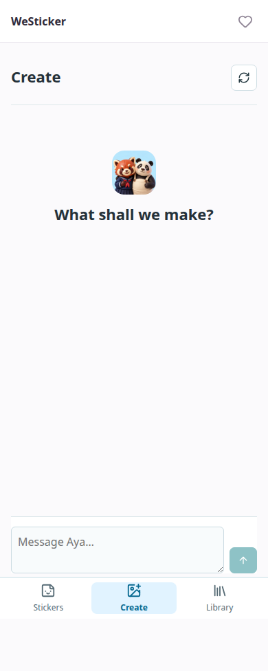
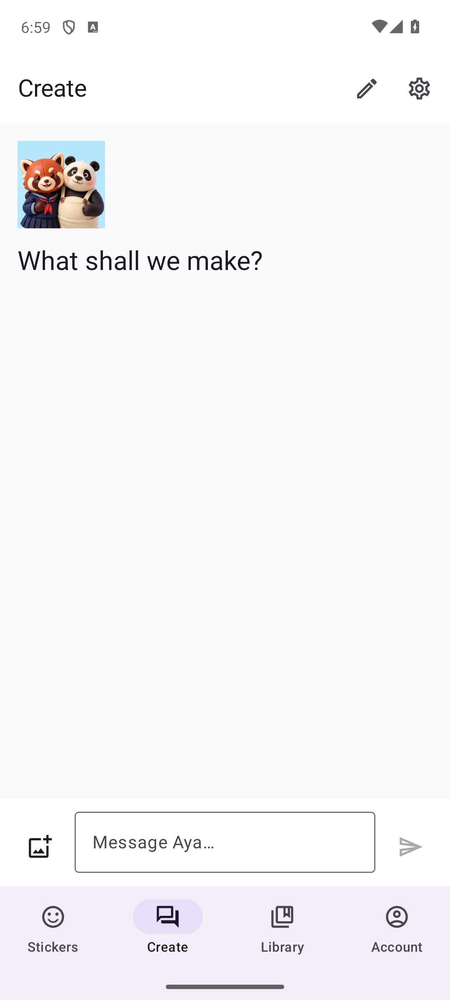
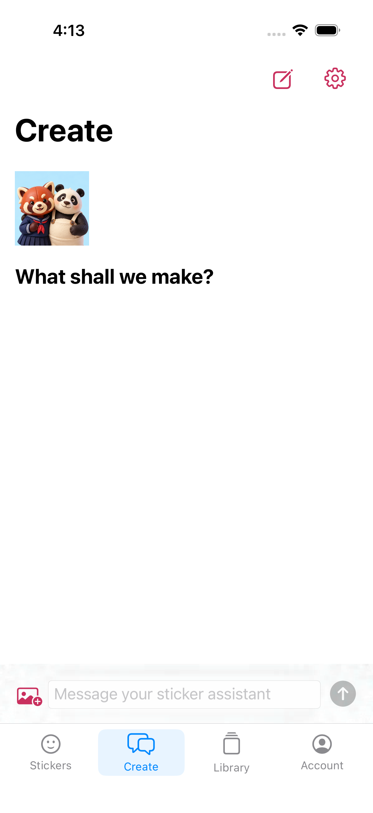

# Clean Chat And Library

Historical release evidence. The owner subsequently clarified that chat requires
login through a separate screen. [Protected Create](protected-create-release-20261011.md)
supersedes the guest entry and endpoint described below; the clean layout remains.

This layout supersedes the separate Characters destination in the earlier
[login/chat release](login-chat-release-20261011.md). The owner requested a simpler,
conversation-first app after trying the previous build.

## Navigation

- Stickers opens the animated public catalog without an account.
- Create opens chat immediately, including while signed out.
- Library contains Creations and Characters. Characters is no longer a global tab.
- Account and billing remain outside the conversation.
- Signed-in Chat and Sticker Plan are separate views of the same creation, rather
  than two crowded panes. Reference approval, quotes and generation safeguards
  are unchanged.

Guest chat is real model-backed conversation, not a local canned reply. The
stateless `/api/guest/chat` endpoint accepts bounded user/assistant history;
system roles, excess context, foreign origins and excess requests are rejected.
It has no tool calls, account mutation, reference upload or credit-spending path.
Guest chat history stays in browser session storage or native app memory.
Cloud references, saved creations and generation still require account/consent.

Web replies support safe Markdown and tables. Raw HTML and remote image embeds
are disabled. The Markdown renderer is loaded only when a reply needs it.
Its lazy chunk is excluded from service-worker precaching, so catalog-only visits
do not download it in the background.

## Verification

- Anonymous real-provider POST against the public HTTPS endpoint returned a reply.
- Guest UI fixtures cover 320, 390, 768 and 1360 pixels, local conversation reload,
  New chat, table rendering, unsafe HTML/image rejection and no global Characters tab.
- The authenticated browser workflow still covers character approval, editable
  proposals, photo preview, review, export, history and Library persistence.
- Guest backend tests cover no account/pack/job side effects, origin/rate guards,
  bounded history, provider error redaction and no automatic request retries.

These checks do not claim a social-login round trip, paid purchase or image render.
See [image qualification](aginti-images.md), [Stripe](stripe-qualification.md) and
[native billing](native-billing.md) for their separate evidence and readiness.

```sh
.venv/bin/python -m pytest -q
node --test tests/*.test.mjs
VITE_PUBLIC_CATALOG_ONLY=true npm run build
.venv/bin/python scripts/test_studio_isolated.py guest
.venv/bin/python scripts/test_studio_isolated.py chat
```

The live web app is [westicker.lazying.art](https://westicker.lazying.art).
Native internal-build receipts remain authoritative for what is installed;
a web deployment alone does not change an installed app.

| Web / phone | Android | iOS |
| --- | --- | --- |
|  |  |  |

The iOS screenshot is build 10. Build 9's existence-only UI check missed a hidden
composer; visual review caught it before internal attachment. Build 10 reserves
layout space for the composer and tests visibility, typing, keyboard placement
and return from Account. The superseded artifact remains private QA evidence.
