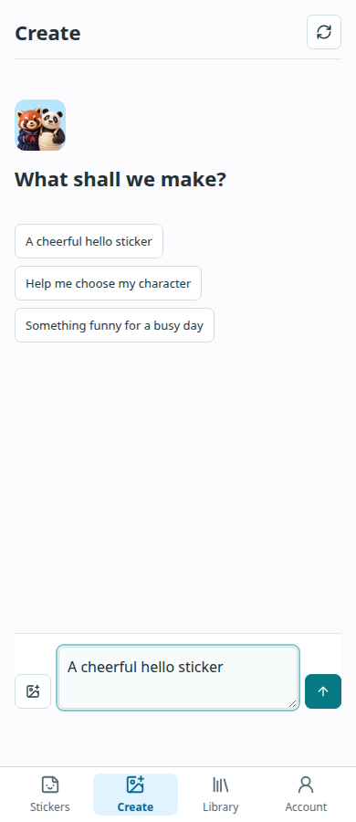

# Compact Workspace

The public PWA has one compact top-left page heading. Protected workspaces no
longer repeat the generic brand header above Create, Library or Account. The
empty chat uses a smaller character icon and keeps its composer near the bottom
of the usable viewport. Selection feedback and short message-entry motion respect
the system reduced-motion preference.




These are real browser captures using an isolated disposable test account, not
customer messages. Browser checks cover widths 320, 390, 768 and 1360, heading
position, overflow, composer visibility, reduced motion and the existing single
root sign-in/expiry flow. Native screenshots and test-build receipts are tracked
separately in the native release note.

```bash
VITE_PUBLIC_CATALOG_ONLY=true npm run build
.venv/bin/python scripts/test_studio_isolated.py login
node scripts/public_login_smoke.mjs
```

Static release: `85ad8b8c9268fff4`. This layout deployment changes no purchase
permissions, login provider configuration or character-generation behavior.
