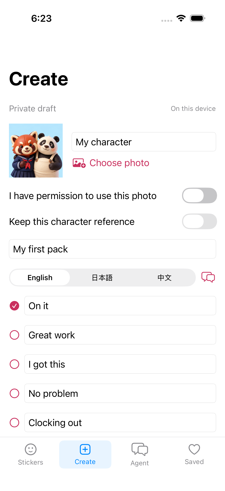
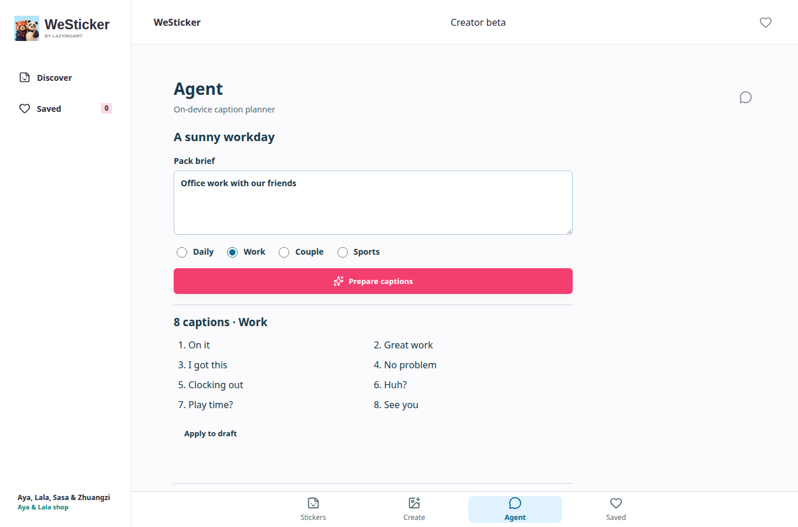

# Local Creator Beta

This increment adds native **Stickers / Create / Agent / Saved** navigation,
a light-blue Aya-and-Lala icon, and a useful local draft workflow. Original
artwork and the previous app icon are preserved.

## Delivered behavior

- Native SwiftUI on iOS/macOS, Compose on Android, separate React PWA.
- Import a photo, confirm permission, lock the reference and edit eight captions.
- Save the draft locally and restore it after relaunch.
- Export a selected caption as an outlined PNG photo sticker through native
  sharing or browser download.
- The Agent tab selects a reviewed Daily, Work, Couple or Sports caption plan
  from a brief. Applying it requires confirmation. English, Japanese and Chinese
  captions share a generated data contract.

The planner is deterministic and on-device, not a connected language model.
Photo exports are not AI-generated character art. Private photos are not sent
to the public catalog server. Cloud generation, shared login, purchases, creator
sales and customer WeChat automation remain disabled in these public betas.

## Evidence

See the [native playback and icon follow-up](native-playback-20261010.md) for
frame-level motion checks and the corrected Mac export.





- Production PWA: <https://aya.lazying.art/westicker/>. The AYA shop root is unchanged.
- iOS 1.0 (4): Apple processed the signed binary and attached it to the existing
  internal TestFlight group. Two simulator UI tests pass, including plan apply,
  relaunch persistence, catalog preview and native sharing.
- Android 1.0 (4): signed APK/AAB; emulator tests pass for catalog, languages,
  preview, native sharing, planner apply and draft persistence. Store rollout is
  recorded separately; building an APK is not proof of Play availability.
- PWA browser tests pass at 320, 390, 768 and 1360 px. Import, rights/lock gates,
  planner confirmation, PNG export and reload persistence pass. No photo POST
  occurs. Catalog offline and original-GIF download tests also pass on the live
  production URL.
- Native photo import/export has implementation and build coverage, but the
  full photo-picker/export path has not been exercised on a physical phone.

## Reproduce

```sh
python3 scripts/export_creator_plans.py
python3 scripts/native_icons.py
python3 scripts/sync_native_catalog.py
.venv/bin/pytest -q
npm run build
WESTICKER_PUBLIC_URL=https://aya.lazying.art/westicker/ node scripts/local_studio_test.mjs
```

`scripts/android_smoke.py --creator` exercises the native draft/planner flow.
Apple tests live in `apple/UITests/CatalogTests.swift`. Release notes supplied
through `apple_beta_publish.py --notes-file` describe the exact candidate rather
than reusing the older catalog-only notes. Keep signing inputs, binary receipts,
private device captures and runtime identifiers outside Git.

The static production preview should match the edge's response headers. Vite
preview's `Vary: Origin` made a local-only offline check misleading; use
`scripts/preview_catalog.py` and still test the actual deployed origin.
