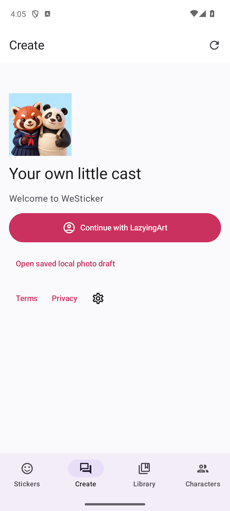
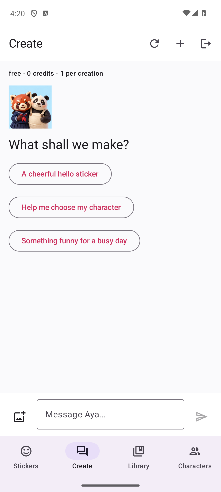

# Login And Conversation Release

Verified 11 October 2026. This supersedes the earlier same-day
[chat-workspace release](chat-beta-release-20261011.md).

## Available

- [WeSticker web app](https://westicker.lazying.art): real LazyingArt password
  signup, consent, login and account reuse. No EchoMind invitation is needed.
- Create opens a conversation. References can be added after the conversation
  starts, without losing its draft. Questions receive conversational replies;
  caption/action changes produce an editable proposal that the user applies.
- Native system-browser sign-in returns automatically to the app. There is no
  manual "I connected my account" step. Drafts survive cancellation/sign-out.
- Chat and Sticker Plan share the same creation. Library and Characters remain
  separate destinations. Guest catalog browsing remains available.
- App-local account deletion now revokes all of that subject's app-bound SDK
  sessions before erasing its mapping. An interrupted revocation can be retried
  without requiring a now-invalid central grant. Other apps are not deleted.

| Native Android login | Native Android conversation |
| --- | --- |
|  |  |


## Internal Builds

| Platform | Build | Provider evidence |
| --- | --- | --- |
| iOS / SwiftUI | 1.0 (7) | VALID, WeSticker Internal, IN_BETA_TESTING |
| macOS / SwiftUI | 1.0 (6) | VALID, WeSticker Internal, IN_BETA_TESTING |
| Android / Compose | 1.0 (7) | Available to internal testers |

Update through the existing TestFlight invitation or the
[Google Play internal track](https://play.google.com/apps/internaltest/4701650698244827462).
These are internal test releases, not public store submissions.

| Artifact | SHA-256 |
| --- | --- |
| Android APK | `58957ed7401c263f69edfdc1609923e1d3a2f2229ea037fb2c12f7e16c896c61` |
| Android AAB | `32e09b9423011fface4384a167142738b47f2d07b7940f00d25facf4cd7fcd73` |
| iOS IPA | `fe6091e91cab6e1c446ecf2bfa474f024d29602feb915939d5505fec8c04b09f` |
| macOS PKG | `b131746f876df0cbbd3992b29d9f43ae899df9185f397c13cc206f26c823a2c8` |

The owner-facing artifact folder is `Share/WeSticker/2026-10-11-login-chat` in the
configured Nutstore sync root. Local checksums verify the copies, not cloud
delivery. Store receipts and account-test evidence remain private.

## Verification

- 77 backend tests; six Node preview-queue and upload-safety tests.
- Full and public-mode web builds; isolated chat, reference binding, table edit,
  photo worker, review, export, version history, library and responsive checks.
- Actual shared password registration and callback with one exact synthetic
  account: consent, reload, same-subject reuse, cancellation, logout and deletion.
- Real LocalLLM reply to a conversational question with no table or render job.
- Independent native S256 approval/exchange, replay rejection and stale-token
  rejection. Callback carries only the link ID, never bearer credentials.
- Exact signed Android build: actual system-browser password login, automatic
  app callback, session restoration after restart and sign-out. Catalog GIF
  pixels, pause/resume, sharing and saved local draft checks also pass.
- iOS simulator: unified creator/local-draft XCTest passes. Apple callback code
  compiles and is in the signed build; its live device round-trip was not tested.
- macOS: signed archive/export and TestFlight processing pass; no new full macOS
  UI login test is claimed.
- Live TLS checks at 390/1360 pixels: no overflow, animated previews, private
  endpoints protected, forged relay/foreign-Origin requests rejected, API no-store.
- Normal app UI deleted the exact test account; its local identities, sessions,
  drafts, jobs, assets and device links were verified absent. Central cleanup is
  separately coordinated with the identity owner, not performed across repos.

## Still Disabled

The shared issuer currently offers password login only. Google, Apple and GitHub
are not presented as connected providers. Image/animation generation, checkout,
creator sales and customer WeChat automation remain disabled pending their own
provider and lifecycle qualification. Working chat is not proof of working image
generation or billing. No paid model call or customer charge occurred in QA.

## Maintainer Notes

`server/shared_identity.py` uses the pinned app-bound identity SDK; secrets stay
in operator configuration. Preserve exact issuer, callback, audience, browser
binding, one-use state and S256 validation. Native return URLs are fixed, and the
native app must match the pending link ID before exchange. Android encrypts its
pending verifier with Keystore; Apple uses `ASWebAuthenticationSession`.

Sign-out removes native local access immediately and retains an encrypted remote
revocation request for retry when necessary. Account deletion calls SDK
`sign_out` before `erase_subject`; it must not erase an unrevoked token family.

`scripts/deploy_creator_edge.py` accepts a complete SHA-256 file manifest plus a
delta archive based on an immutable previous release. Unchanged media is linked
locally on the edge; changed files detach before writing. Every file is verified,
and existing snapshots must match rather than be overwritten. This update
transferred roughly 83 KB instead of resending the roughly 61 MB static catalog.
Other hostnames and firewall rules remain untouched.

```sh
.venv/bin/pytest -q
node --test tests/wechat.test.mjs tests/preview-queue.test.mjs
npm run build
.venv/bin/python scripts/test_studio_isolated.py chat
VITE_PUBLIC_CATALOG_ONLY=true npm run build
.venv/bin/python scripts/test_studio_isolated.py chat
node scripts/creator_edge_test.mjs
```

See [beta notes](login-chat-beta-notes.txt) for the exact distributed scope.
