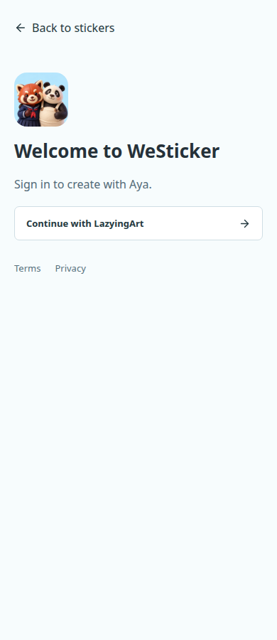

# Public Stickers, Protected Create

The owner clarified that chat requires login. "Chat is chat" means authentication
belongs on its own screen, outside the conversation. This supersedes the earlier
guest-chat interpretation; the simpler layout and Library organization remain.

The October 12 follow-up additionally moves login outside the entire tab shell.
Create, Library and Account use the same root login screen rather than repeating
sign-in controls inside each tab. The intended destination is retained.

## Navigation

1. **Stickers:** public starting screen, animated collections and individual downloads.
2. **Create:** a separate sign-in screen when signed out; authenticated conversation
   and editable sticker plans afterward. No account or billing controls in the chat.
3. **Library:** creations, character references and the preserved local photo draft.
4. **Account:** profile, plan management, sign-out and app-scoped deletion.

The public catalog does not expose private or unreviewed user creations.
Existing reference consent, character approval, quotes and generation attempt IDs
are unchanged. Native iOS/macOS use SwiftUI; Android uses Compose.

## Authentication

- Existing LazyingArt system-browser/PKCE login is reused, not replaced by a WebView.
- Web login restores only the fixed Create, Library or Account destinations.
  Arbitrary redirects are refused. Native one-use completion remains unchanged.
- Expired protected sessions return to sign-in rather than anonymous chat.
- Revoked sessions can still retrieve public login discovery; the stale browser
  cookie is cleared without erasing the account or its drafts. An issuer outage
  remains an error, not an authorization success.
- A valid, issuer-verified LazyingArt app session returns directly to the intended
  screen. Local-only identities are not treated as shared identities.
- Native provider selection starts authorization directly. Its explicit device
  approval and one-use PKCE return use a separate completion screen, not chat.
- Interrupted browser authorization retains its error status but renders a safe
  retry/browse screen. Callback codes and query parameters are never echoed.
- The retired `/api/guest/chat` returns an upgrade/sign-in response and invokes
  no model. Older installed clients cannot use it as an anonymous bypass.
- The login screen shows only configured providers. Central provider readiness
  and a completed WeSticker login are separate evidence; see
  [social qualification](social-auth-qualification-20261011.md).

## Verification

The full and public web builds passed. Isolated browser checks cover public
browsing, login/registration return, cancellation routing, session expiry, password
visibility, reference upload, character approval, proposal editing, photo preview,
review, ZIP export, account deletion and preserved Library navigation. Layout
checks span 320, 390, 768 and 1360 pixels. These tests make no paid model request.
The four-provider layout fixture verifies labels and distinct destinations only;
it does not qualify Google, Apple or GitHub authorization. Native completion is
tested separately with an isolated real link/approval/PKCE exchange and no chat
requests. Full local catalog regression serves approved GIF bytes locally to avoid
repeated edge downloads; live HTTPS checks remain separate evidence.

The live HTTPS smoke verifies the four public navigation tabs, separate sign-in,
return to browsing, the LazyingArt entry, protected-workspace 401 and retired-chat
410 at phone and desktop widths. Existing web checkout recovery tests still pass;
they do not qualify live payment processing.

```sh
.venv/bin/python -m pytest -q
node --test tests/*.test.mjs
VITE_PUBLIC_CATALOG_ONLY=true npm run build
.venv/bin/python scripts/test_studio_isolated.py login
.venv/bin/python scripts/test_studio_isolated.py chat
WESTICKER_QA_ART_ROOT=/path/to/approved-shop/build/public \
  .venv/bin/python scripts/test_studio_isolated.py browser
.venv/bin/python scripts/test_studio_isolated.py billing
node scripts/public_login_smoke.mjs
```

[Live web app](https://westicker.lazying.art) ·
[Native build evidence](native-protected-create-20261011.md) ·
[Release readiness](release-readiness.md)



Backend activation waits for an idle queue and preserves rollback. Static releases
are immutable and transfer only changed files. Private runtime paths and release
receipts stay outside Git; artwork, credentials and installed sessions are not
copied into this documentation.
