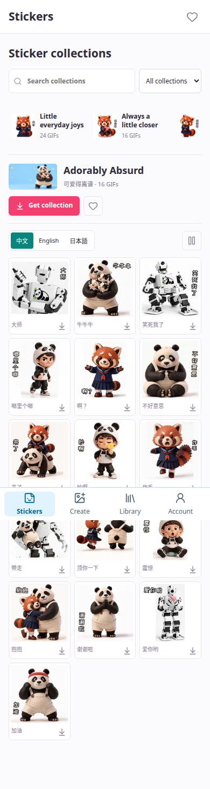

# Shared Public Artwork Catalog

The creator PWA at <https://westicker.lazying.art> uses AYA's approved public
catalog, not an independently maintained list of owner packs. New public AYA
editions therefore appear without rebuilding the PWA. Customer libraries,
identity, subscriptions, prices and purchase records remain app-owned.

## Runtime Contract

- Enable `public_catalog_sync: true` in the private creator configuration.
- `server/public_catalog.py` fetches only
  `https://aya.lazying.art/catalog.json`, with no redirects, a four-second timeout,
  a 2 MB body limit, complete zh/en/ja editions and an artwork URL allowlist.
- A 300-second cache and conditional ETag requests limit edge traffic. Failed
  refreshes keep a validated disk cache; a bundled catalog is the final fallback.
- `/api/catalog` returns a stable `source_revision` and its own response ETag.
- `PublicCatalog.tsx` refreshes on entry, visible revisit and five-minute visible
  intervals. It retains the selected collection; the initial selection follows
  AYA's approved default. Hidden tabs do not poll.
- Motion previews retain the existing three-transfer queue. Save/preview uses
  the full original GIF. Service workers exclude API and authentication routes.
- Public GIF lookup uses the same live catalog. Paid collection download remains
  separately entitlement-checked; install approved ZIPs into the configured
  artifact store instead of importing AYA orders or billing state.

## Build And Verify

```bash
npm run build:creator
.venv/bin/pytest -q tests/test_public_catalog.py
```

The default UI is the current public-browse/creator app. The historical
`VITE_PUBLIC_CATALOG_ONLY` flag now defaults to that app; explicitly setting
`false` selects the legacy prototype. Always use `build:creator` for deployment.
Verify the bottom navigation (Stickers, Create, Library, Account) and the single
app-level sign-in screen for protected tabs, not just a gallery screenshot.

Use the existing content-addressed staging, idle-queue activation and guarded
creator edge deployment. Preserve account/financial settings and previous
releases. Do not copy this app back under the retired AYA `/westicker/` entrance.

The cross-site live test is in LALACHAN:
`scripts/test_shared_sticker_catalog.mjs`. It compares every pack ID and each
language's sticker IDs/labels/GIF URLs, then checks mobile/desktop layout,
animation and the protected Create route. Public-only screenshots and receipts
are separate from private account evidence.

## Native Scope

Android `PublicCatalogStore.kt` and Apple `PublicCatalogStore.swift` load the
same API with cached/bundled fallback. Android Compose sources passed cached
toolchain typechecking. Apple sources have not been compiled in this round;
no new iOS/macOS/Android build has been distributed for this catalog change.
Previously installed native releases still use their bundled implementation.
Include the readers in the next qualified native test build before claiming
automatic catalog updates on installed devices.



## Current Public Release

On 2026-10-16 AYA and the PWA expose the same 12 packs (188 selected animations),
including Adorably Absurd and Silly but Sweet. Both new packs provide zh/en/ja
artwork. AYA's free ZIPs are public; new paid shop checkout is not activated.
Existing WeSticker collection subscriptions retain their prior rules.
