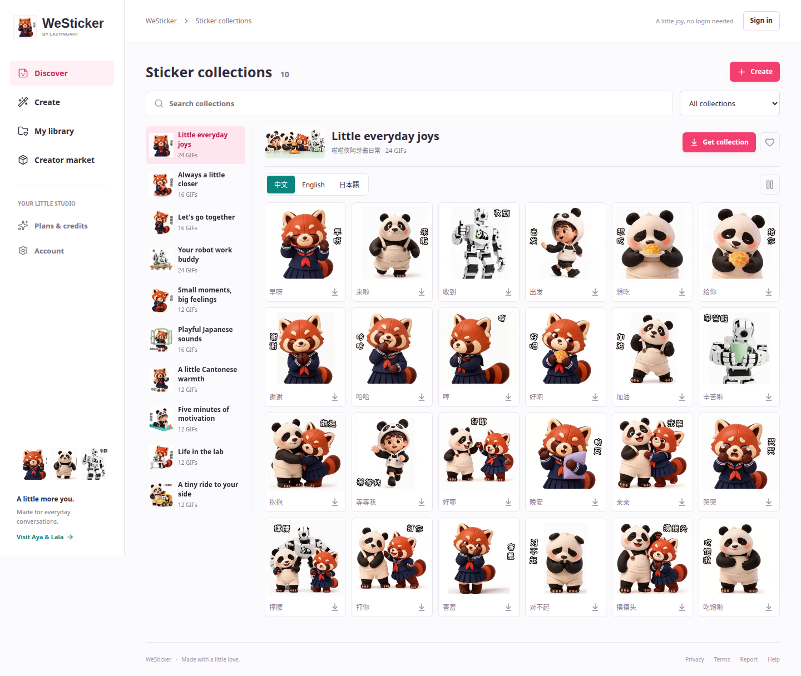
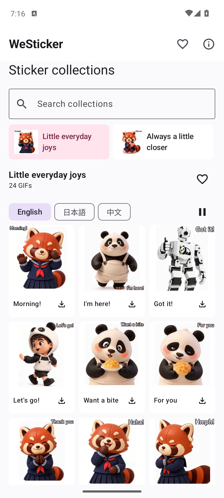
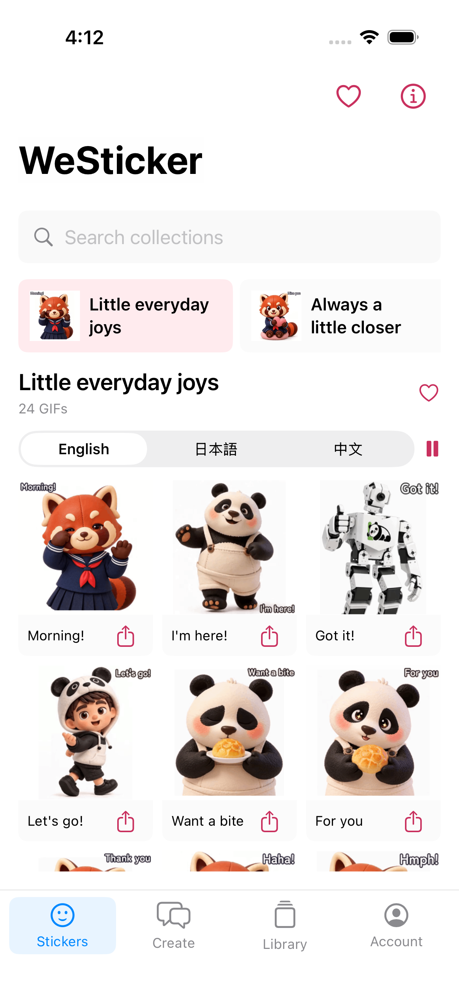
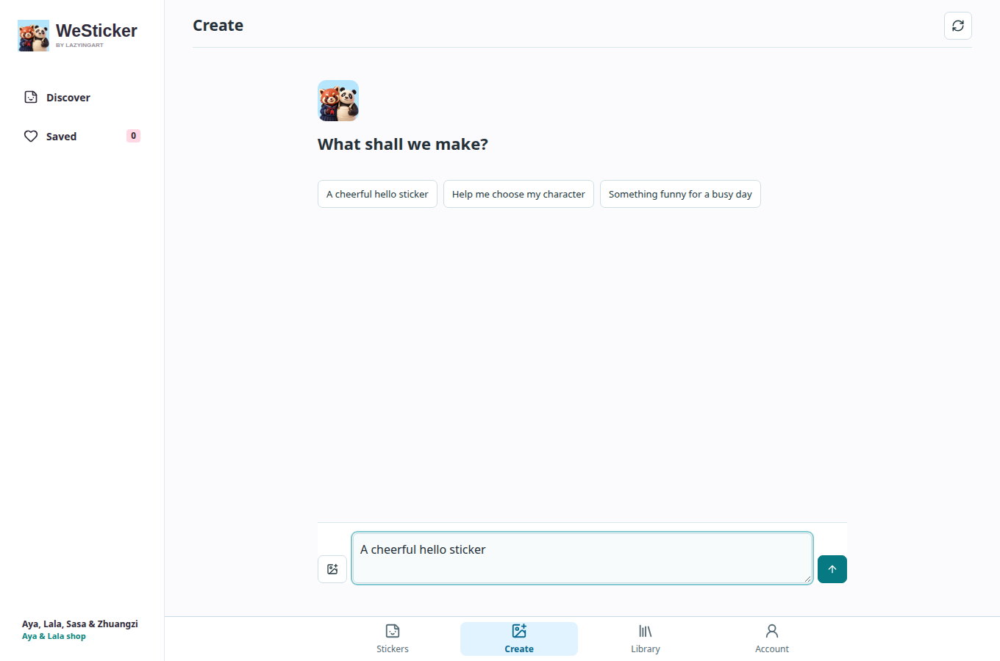
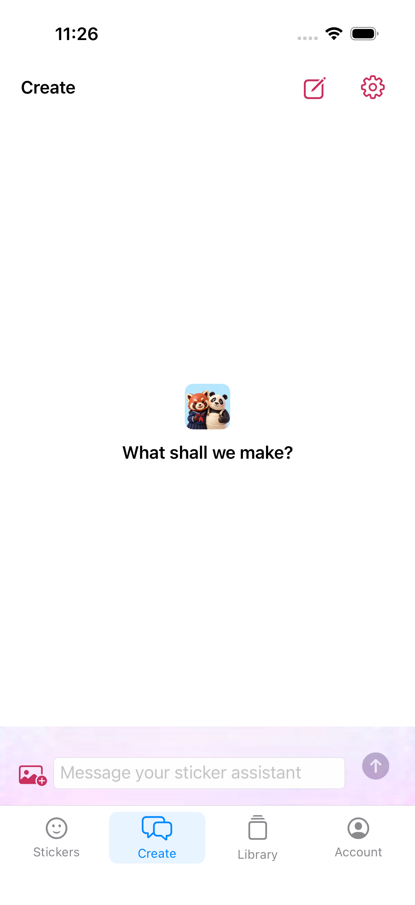

[English](../README.md) · [العربية](README.ar.md) · [Español](README.es.md) · [Français](README.fr.md) · [日本語](README.ja.md) · [한국어](README.ko.md) · [Tiếng Việt](README.vi.md) · [中文 (简体)](README.zh-Hans.md) · [中文（繁體）](README.zh-Hant.md) · [Deutsch](README.de.md) · [Русский](README.ru.md)

[](https://lazying.art)

# WeSticker

*شخصيتك، وتعابيرك الصغيرة كل يوم.*

[](https://lazying.art) [](../docs/release-readiness.md) [](https://westicker.lazying.art) [](https://github.com/sponsors/lachlanchen)

استوديو مستقل لملصقات Aya وأصدقائها ولشخصيات المستخدمين ومجموعاتهم. يمكن مشاهدة الأعمال الافتراضية دون تسجيل الدخول، بينما تُعالج الصور الشخصية في مساحة خاصة. متجر AYA الحالي لم يتغير.

| Donate | PayPal | Stripe |
| --- | --- | --- |
| [](https://chat.lazying.art/donate) | [](https://paypal.me/RongzhouChen) | [](https://buy.stripe.com/aFadR8gIaflgfQV6T4fw400) |



| Android / Compose | iOS / SwiftUI |
| --- | --- |
|  |  |

[Native beta scope](../docs/native-catalog-beta.md) · [Creator roadmap](../docs/native-creator-plan.md) · [Bandwidth](../docs/catalog-bandwidth.md)

[Create / Agent beta update · 2026-10-10](../docs/creator-beta-20261010.md) · [Japanese LINE editions](../docs/line-japanese-editions.md)

[GIF playback, new icon and test-build evidence](../docs/native-playback-20261010.md)

**2026-10-11** · يمكن تصفح الملصقات دون تسجيل الدخول. يفتح Create شاشة دخول مستقلة ثم محادثة بسيطة. الشخصيات والمراجع في Library، وAccount هو التبويب الأخير.

[2026-10-11 · Public stickers / protected Create](../docs/protected-create-release-20261011.md) · [Native test builds](../docs/native-protected-create-20261011.md) · [Login qualification](../docs/social-auth-qualification-20261011.md) · [AgInTi qualification](../docs/aginti-images.md)

[2026-10-12 · Completion ledger](../docs/request-completion-ledger.md) · [Compact native builds](../docs/compact-native-release-20261012.md) · [Web subscription evidence](../docs/stripe-qualification.md)





[Native layout test scope](../docs/native-compact-toolbar-20261012.md)

## الاستوديو

- 10 مجموعات و156 حركة مستقلة، مع نصوص صينية وإنجليزية ويابانية ومعاينة فورية.
- رفع صور خاصة، وشخصيات مؤكدة قابلة لإعادة الاستخدام، ومسودات ضمن حدود الخطة، وتحرير النصوص، وموافقة لكل ملصق وتصدير ZIP.
- توليد صور وتحريك محلي ومراجعة بيع ورفع مسودات WeChat في متصفح معزول كخيارات إضافية. يحفظ المساعد المسودات فقط ولا يرسلها للمراجعة.

## الخطط

الاشتراكات الشهرية على الويب متاحة: Pocket بسعر 0.99 دولار و3 أرصدة، وCreator بسعر 9.99 دولار و40 رصيداً، وStudio بسعر 24.99 دولار و120 رصيداً. وضع الصور مجاني. تشمل الخطط ملفات ZIP للمجموعات الافتراضية بلغات النص الثلاث. تُختبر مشتريات التطبيقات وخدمات التحريك والرفع الاختيارية بشكل منفصل.

## التشغيل محلياً

يتطلب Python 3.12+ وNode 22+ وخط CJK وChromium لاختبارات المتصفح. ينشئ البرنامج إعداد عرض خاصاً دون استعارة بيانات اعتماد تطبيق آخر. افتح http://127.0.0.1:18642 وأوقفه عبر `python3 scripts/dev.py stop`.

```bash
python3 -m venv .venv
.venv/bin/pip install -r requirements.txt
npm ci
python3 scripts/configure_local.py
npm run build
python3 scripts/dev.py start
```

## البنية

تطبيق Android أصلي باستخدام Kotlin/Jetpack Compose وتطبيقا iOS/macOS باستخدام SwiftUI، مع PWA منفصلة بـ React/Vite. نموذج الإنشاء الخاص يستخدم Python وSQLite. الواجهة بالإنجليزية ونصوص الملصقات بالصينية والإنجليزية واليابانية.

| Path | Document |
| --- | --- |
| `src/`, `server/` | [Architecture](../docs/architecture.md) |
| `worker/`, `compose.yaml` | [Deployment](../docs/deployment.md) |
| `android/`, `apple/`, `macos/` | [Release readiness](../docs/release-readiness.md) |
| `server/auth.py`, `server/billing.py` | [Integration handoff](../docs/integration-handoff.md) |

## التحقق

تغطي الاختبارات التصفح العام والمحادثة المحمية والعودة بعد الدخول وانتهاء الجلسة والمراجع والمراجعة والتصدير. تُوثّق أدلة الإصدارات الأصلية بشكل منفصل.

```bash
.venv/bin/pytest -q
node --test tests/wechat.test.mjs
npm run build
npm audit
npm run test:browser
```

## حالة الإصدار

نسخة إنشاء تجريبية داخلية مع اشتراكات ويب فعالة، وليست إصداراً تجارياً مكتملاً. تم التحقق من الدخول بكلمة المرور وGoogle وApple عبر LazyingArt وتوليد الصور عبر AgInTi. لا تزال مهام GitHub والاختيار المباشر للمزوّد والمشتريات الأصلية والتحريك العام ومبيعات المبدعين ورفع WeChat المعزول لكل مستخدم مسجلة في قائمة الإنجاز.

## الاستشهاد

الكود بترخيص MIT، والرسوم لها حقوق منفصلة. يرجى الاستشهاد بالمستودع عند استخدامه في البحث. [CITATION.cff](../CITATION.cff) · [MIT](../LICENSE) · [Artwork](../ARTWORK-LICENSE.md)

```bibtex
@software{chen_westicker_2026,
  author = {Chen, Lachlan},
  title = {WeSticker: A Personal Sticker Creation Studio},
  year = {2026},
  url = {https://github.com/lachlanchen/WeSticker}
}
```
