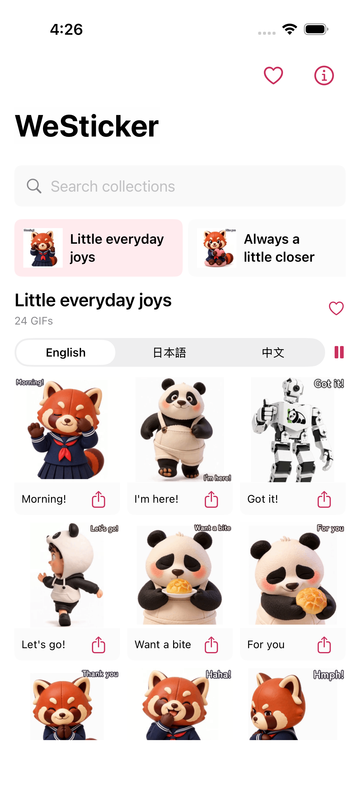

[English](../README.md) · [العربية](README.ar.md) · [Español](README.es.md) · [Français](README.fr.md) · [日本語](README.ja.md) · [한국어](README.ko.md) · [Tiếng Việt](README.vi.md) · [中文 (简体)](README.zh-Hans.md) · [中文（繁體）](README.zh-Hant.md) · [Deutsch](README.de.md) · [Русский](README.ru.md)

[](https://github.com/lachlanchen/lachlanchen/blob/main/figs/banner.png)

# WeSticker

*Votre personnage, vos petites expressions du quotidien.*

[](https://lazying.art) [](../docs/release-readiness.md) [](https://aya.lazying.art/westicker/) [](https://github.com/sponsors/lachlanchen)

Un studio indépendant pour Aya et ses amis, vos personnages et vos collections. Les créations par défaut sont visibles sans connexion ; les photos personnelles restent dans un espace privé. La boutique AYA existante est inchangée.

| Donate | PayPal | Stripe |
| --- | --- | --- |
| [](https://chat.lazying.art/donate) | [](https://paypal.me/RongzhouChen) | [](https://buy.stripe.com/aFadR8gIaflgfQV6T4fw400) |


| Android / Compose | iOS / SwiftUI |
| --- | --- |
|  |  |

[Native beta scope](../docs/native-catalog-beta.md) · [Creator roadmap](../docs/native-creator-plan.md) · [Bandwidth](../docs/catalog-bandwidth.md)

## Le studio

- 10 collections, 156 animations distinctes, versions chinoise, anglaise et japonaise avec aperçu immédiat.
- Photos privées, personnage validé réutilisable, brouillons de huit expressions, textes modifiables, validation individuelle et export ZIP.
- Génération d’images, animation locale, examen des ventes et envoi de brouillons WeChat isolé en option. L’assistant enregistre seulement les brouillons, sans soumettre à examen.

## Formules

Abonnements mensuels proposés : Pocket 0,99 $ / 3 crédits image ; Creator 9,99 $ / 40 ; Studio 24,99 $ / 120 et assistance d’envoi facultative. Le mode photo est gratuit ; une animation coûte 3 crédits. Aucun paiement avant connexion et validation.

## Exécution locale

Python 3.12+, Node 22+, police CJK et Chromium pour les tests navigateur. Le script crée une configuration de démonstration privée, sans emprunter les identifiants d’une autre application. Ouvrez http://127.0.0.1:18642. Arrêtez avec `python3 scripts/dev.py stop`.

```bash
python3 -m venv .venv
.venv/bin/pip install -r requirements.txt
npm ci
python3 scripts/configure_local.py
npm run build
python3 scripts/dev.py start
```

## Architecture

Android natif en Kotlin/Jetpack Compose, iOS/macOS en SwiftUI et PWA séparée en React/Vite. Le prototype privé de création utilise Python et SQLite. Interface anglaise, textes des stickers en chinois, anglais et japonais.

| Path | Document |
| --- | --- |
| `src/`, `server/` | [Architecture](../docs/architecture.md) |
| `worker/`, `compose.yaml` | [Deployment](../docs/deployment.md) |
| `android/`, `apple/`, `macos/` | [Release readiness](../docs/release-readiness.md) |
| `server/auth.py`, `server/billing.py` | [Integration handoff](../docs/integration-handoff.md) |

## Vérification

46 tests backend et deux tests de sécurité de l’agent passent. Un vrai navigateur a vérifié téléchargement, photos, validation du personnage, génération photo, révision, ZIP et suppression de compte aux tailles mobile et bureau. Ce ne sont pas des tests de paiement réel ou de fournisseur IA.

```bash
.venv/bin/pytest -q
node --test tests/wechat.test.mjs
npm run build
npm audit
npm run test:browser
```

## État de publication

Le catalogue PWA est en ligne sur https://aya.lazying.art/westicker/. Les versions natives visent les tests internes Google Play et Apple TestFlight ; disponibilité et limites de validation figurent dans le suivi des versions. Création IA, connexion, abonnements et ventes restent désactivés dans ces bêtas.

## Citation

Code sous MIT ; illustrations sous droits distincts. Citez ce dépôt pour un usage scientifique. [CITATION.cff](../CITATION.cff) · [MIT](../LICENSE) · [Artwork](../ARTWORK-LICENSE.md)

```bibtex
@software{chen_westicker_2026,
  author = {Chen, Lachlan},
  title = {WeSticker: A Personal Sticker Creation Studio},
  year = {2026},
  url = {https://github.com/lachlanchen/WeSticker}
}
```
