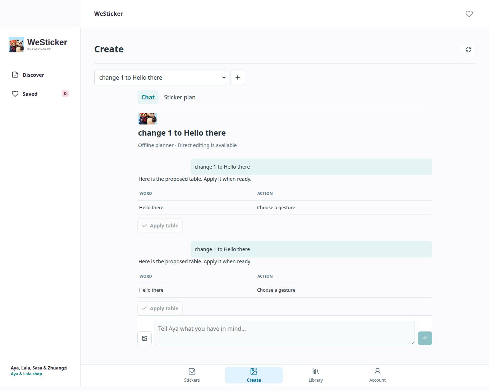

[English](../README.md) · [العربية](README.ar.md) · [Español](README.es.md) · [Français](README.fr.md) · [日本語](README.ja.md) · [한국어](README.ko.md) · [Tiếng Việt](README.vi.md) · [中文 (简体)](README.zh-Hans.md) · [中文（繁體）](README.zh-Hant.md) · [Deutsch](README.de.md) · [Русский](README.ru.md)

[](https://github.com/lachlanchen/lachlanchen/blob/main/figs/banner.png)

# WeSticker

*あなたのキャラクターで、毎日の気持ちを。*

[](https://lazying.art) [](../docs/release-readiness.md) [](https://aya.lazying.art/westicker/) [](https://github.com/sponsors/lachlanchen)

阿芽と仲間たちの作品を楽しみ、自分だけのキャラクターとスタンプを作る独立したスタジオです。標準作品はログインなしで閲覧でき、個人素材は非公開の作業領域で扱います。既存の AYA ショップは変更していません。

| Donate | PayPal | Stripe |
| --- | --- | --- |
| [](https://chat.lazying.art/donate) | [](https://paypal.me/RongzhouChen) | [](https://buy.stripe.com/aFadR8gIaflgfQV6T4fw400) |


| Android / Compose | iOS / SwiftUI |
| --- | --- |
|  |  |

[Native beta scope](../docs/native-catalog-beta.md) · [Creator roadmap](../docs/native-creator-plan.md) · [Bandwidth](../docs/catalog-bandwidth.md)

[Create / Agent beta update · 2026-10-10](../docs/creator-beta-20261010.md) · [Japanese LINE editions](../docs/line-japanese-editions.md)

[GIF playback, new icon and test-build evidence](../docs/native-playback-20261010.md)

**2026-10-11** · Create と Agent を統合し、編集できる文字・動作表、ライブラリとキャラクター管理を追加しました。iOS 1.0 (6)、macOS 1.0 (5)、Android 1.0 (5) は内部テストで利用できます。独立した Web アプリは https://westicker.lazying.art です。共有アカウント登録、画像・動画生成、決済の接続と検証は未完了で、制作サービス全体の正式公開ではありません。

[2026-10-11 · Internal builds / HTTPS](../docs/chat-beta-release-20261011.md) · [API / QA](../docs/chat-studio-20261011.md)



## スタジオ

- 標準10パック、156種類のアニメーション、中国語・英語・日本語の文字版をすぐにプレビュー。
- 非公開の写真アップロード、再利用できる固定キャラクター、8種類の表情、文字編集、個別確認と ZIP 出力。
- 画像生成、ローカル動画化、販売審査、隔離ブラウザーでの WeChat 下書きアップロードは任意機能です。助手は下書き保存のみで、審査には提出しません。

## プラン

月額案は Pocket $0.99 / 画像3クレジット、Creator $9.99 / 40、Studio $24.99 / 120 と任意のアップロード支援。写真モードは無料、アニメーションは3クレジット。決済の接続・検証までは販売しません。

## ローカル実行

Python 3.12+、Node 22+、CJK フォント、ブラウザーテスト用 Chromium が必要です。他アプリの認証情報は流用せず、専用の非公開デモ設定を作成します。http://127.0.0.1:18642 を開き、`python3 scripts/dev.py stop` で停止します。

```bash
python3 -m venv .venv
.venv/bin/pip install -r requirements.txt
npm ci
python3 scripts/configure_local.py
npm run build
python3 scripts/dev.py start
```

## 構成

Android は Kotlin/Jetpack Compose、iOS/macOS は SwiftUI のネイティブ実装です。PWA は独立した React/Vite、非公開の制作試作版は Python と SQLite を使用。画面は英語、スタンプ文字は中国語・英語・日本語です。

| Path | Document |
| --- | --- |
| `src/`, `server/` | [Architecture](../docs/architecture.md) |
| `worker/`, `compose.yaml` | [Deployment](../docs/deployment.md) |
| `android/`, `apple/`, `macos/` | [Release readiness](../docs/release-readiness.md) |
| `server/auth.py`, `server/billing.py` | [Integration handoff](../docs/integration-handoff.md) |

## 検証

バックエンド72件とブラウザーエージェント安全テスト2件に合格。実ブラウザーで閲覧・ダウンロード、写真アップロード、キャラクター確認、写真スタンプ生成、文字確認、ZIP 出力、アカウント削除をデスクトップとモバイル幅で検証しました。実決済や AI サービスの検証ではありません。

```bash
.venv/bin/pytest -q
node --test tests/wechat.test.mjs
npm run build
npm audit
npm run test:browser
```

## リリース状況

Create と Agent を統合し、編集できる文字・動作表、ライブラリとキャラクター管理を追加しました。iOS 1.0 (6)、macOS 1.0 (5)、Android 1.0 (5) は内部テストで利用できます。独立した Web アプリは https://westicker.lazying.art です。共有アカウント登録、画像・動画生成、決済の接続と検証は未完了で、制作サービス全体の正式公開ではありません。

## 引用

コードは MIT、キャラクターと画像は別の権利条件です。研究に利用する際は本リポジトリを引用してください。 [CITATION.cff](../CITATION.cff) · [MIT](../LICENSE) · [Artwork](../ARTWORK-LICENSE.md)

```bibtex
@software{chen_westicker_2026,
  author = {Chen, Lachlan},
  title = {WeSticker: A Personal Sticker Creation Studio},
  year = {2026},
  url = {https://github.com/lachlanchen/WeSticker}
}
```
